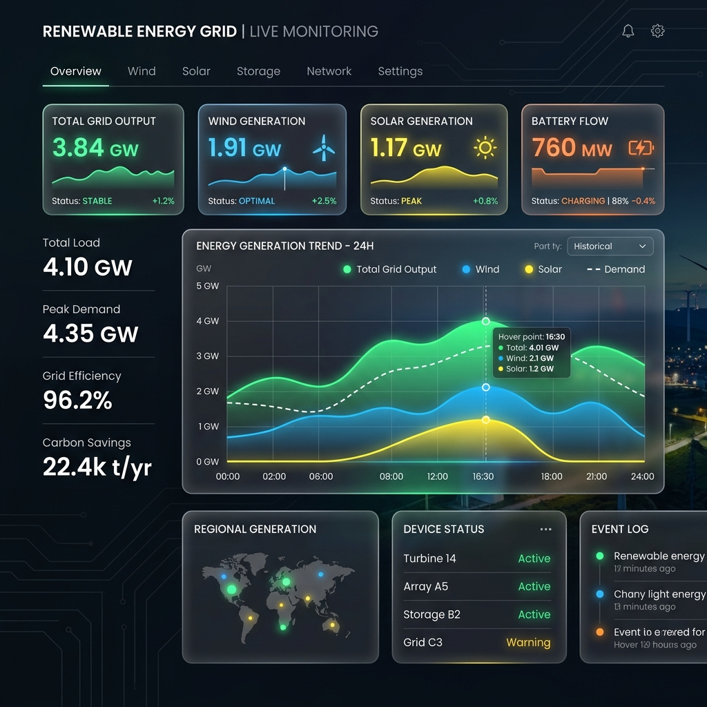
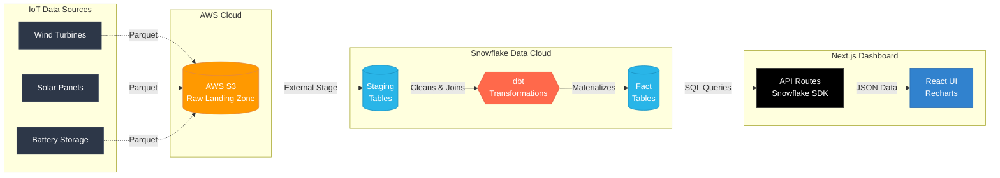

<div align="center">
  # ⚡ Renewable Energy Monitoring Grid
  
  **End-to-End Data Pipeline & Telemetry Dashboard for Renewable Energy Assets**

  <p align="center">
    
    
    
    
    
  </p>
</div>

---

## 📖 About The Project

This project is a complete end-to-end data engineering pipeline designed to monitor and optimize renewable energy assets. 

Managing a modern renewable energy grid requires instantaneous observability over wind turbines, solar panels, and battery storage. A failure to balance grid loads or detect degraded equipment performance can lead to significant power outages or financial losses. This platform bridges the gap between raw IoT device telemetry and actionable grid intelligence.

By aggregating real-time data from wind, solar, and battery assets into AWS S3, loading it into a centralized Snowflake data warehouse, and transforming it via dbt, this Next.js dashboard provides grid operators with instantaneous visibility into **total power output, specific asset generation, and battery flow**.

### ✨ Technical Capabilities & Skills
- **Data Engineering**: Architected an ELT pipeline moving raw simulated IoT data into AWS S3 and utilizing Snowflake Snowpipe for continuous ingestion.
- **Data Transformation**: Wrote custom `dbt` models to clean, join, and aggregate the raw data into business-ready Fact and Dimension tables.
- **Frontend Engineering**: Built a responsive, highly-interactive SPA using Next.js App Router and React.
- **UI/UX Design**: Implemented a modern, glassmorphic design system using custom CSS modules and interactive Recharts visualizations.
- **System Architecture**: Designed a decoupled architecture separating the raw data generation and ingestion from the business analytics layer.

---

## 📸 Dashboard Previews

<div align="center">
  
  <p><i>Main Dashboard Interface: Real-time KPIs and 24-Hour Generation Trends</i></p>
</div>

---

## 🏗️ System Architecture



1. **Generation (Python Simulator)**: A custom Python script generates realistic time-series telemetry for wind, solar, and battery assets, saving them as Parquet files.
2. **Ingestion (AWS S3)**: Raw telemetry logs are uploaded to secure S3 landing buckets partitioned by source type and time.
3. **Storage (Snowflake)**: External stages and Snowpipes are configured in Snowflake to automatically ingest the raw S3 data into staging tables.
4. **Transformation (dbt)**: `dbt` (Data Build Tool) is used to clean, join, and aggregate the raw data into business-ready Fact (`fct_grid_performance_hourly`) tables.
5. **API Layer (Next.js)**: Next.js API routes query the transformed Snowflake views securely using the Snowflake Node.js SDK.
6. **Presentation (React)**: The client-side dashboard fetches the data, performs final formatting, and renders it through interactive Recharts.

---

## 🚀 Getting Started

To run this project locally, you will need to set up the data warehouse, dbt, and the frontend application.

### 1. Data Generation & Ingestion
1. Install Python dependencies in `/simulator` and run the generator:
   ```bash
   python generate_telemetry.py --backfill 1
   ```
2. Set up your `.env` with AWS credentials and run `/ingestion/setup_s3.py` and `upload_to_s3.py`.

### 2. Snowflake & Database Setup
1. Create a Snowflake account.
2. Run the initialization scripts found in `snowflake/01_setup_integration_stage.sql` to configure the S3 integration.
3. Run `snowflake/02_raw_tables.sql` to create the raw tables.
4. Set up the Snowpipes in `snowflake/03_snowpipe_copy.sql` to ingest the data.

### 3. dbt Transformation
1. Navigate to the `dbt_project` directory.
2. Configure your `profiles.yml` with your Snowflake credentials.
3. Run the models:
   ```bash
   dbt deps
   dbt build
   ```

### 4. Frontend Setup
1. Navigate to the `dashboard` directory.
2. Install dependencies:
   ```bash
   npm install
   ```
3. Ensure your root `.env` has your Snowflake credentials filled out.
4. Start the development server:
   ```bash
   npm run dev
   ```
5. Open [http://localhost:3000](http://localhost:3000) in your browser.

---

## 🛠️ Built With

* [Next.js](https://nextjs.org/) - React Framework
* [Snowflake](https://www.snowflake.com/) - Cloud Data Platform
* [dbt](https://www.getdbt.com/) - Data Transformation
* [AWS S3](https://aws.amazon.com/s3/) - Cloud Object Storage
* [Recharts](https://recharts.org/) - Charting Library
* [Lucide Icons](https://lucide.dev/) - Iconography

---

## 👨‍💻 Author & License

Developed with 💙 by **Sachin Sahu**
- **GitHub:** [@sachinsahu19](https://github.com/sachinsahu19)
- **Repository:** [https://github.com/sachinsahu19/renewable-energy-data-pipeline](https://github.com/sachinsahu19/renewable-energy-data-pipeline)

Distributed under the **MIT License**.
